# Esta es la tarea del alumno Simón Jiménez del curso ASIR2, módulo SRI.

# Apartado 1. Tu red y tu instancia en AWS

### VPC:

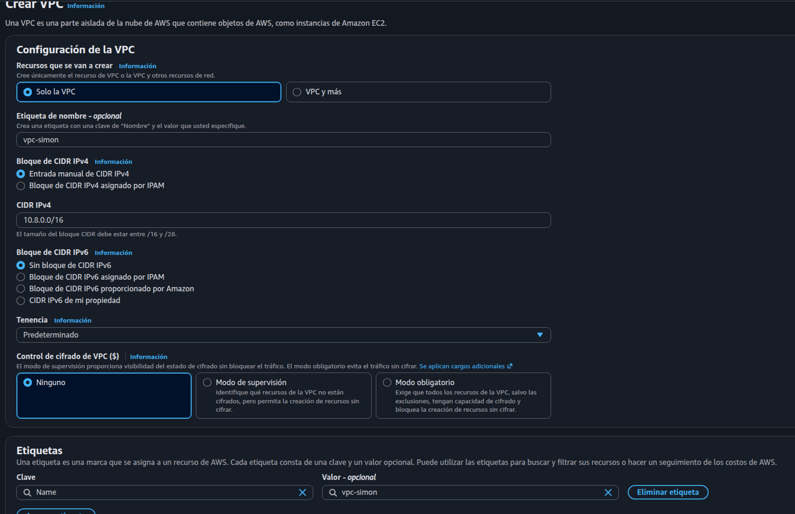

### Subred pública:

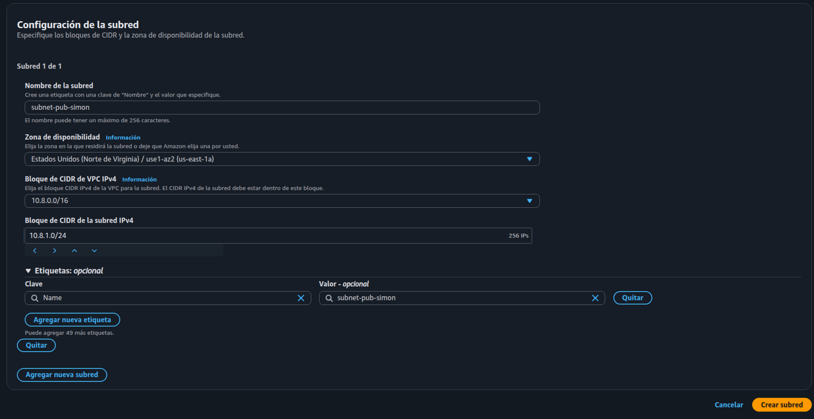
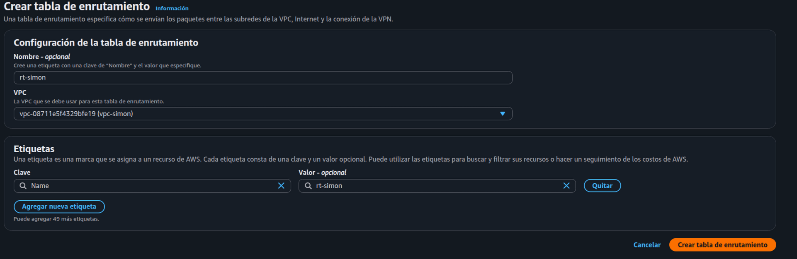
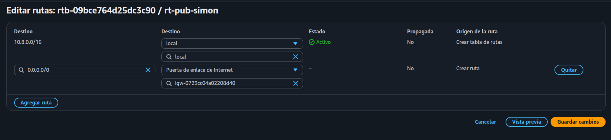


### Grupo de seguridad con mínimo privilegio:

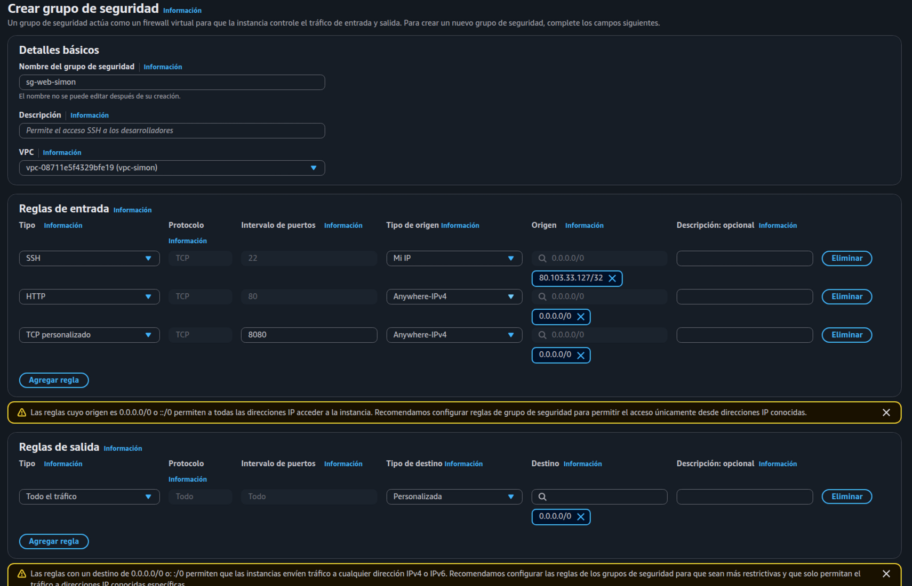

### Instancia EC2:

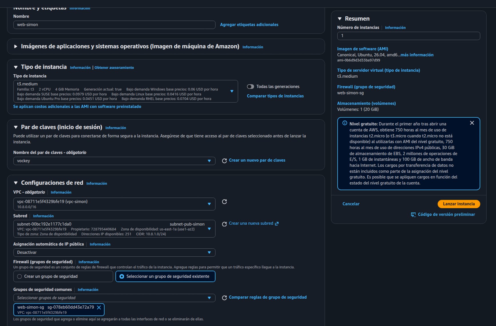

#### Detalles de la instancia:

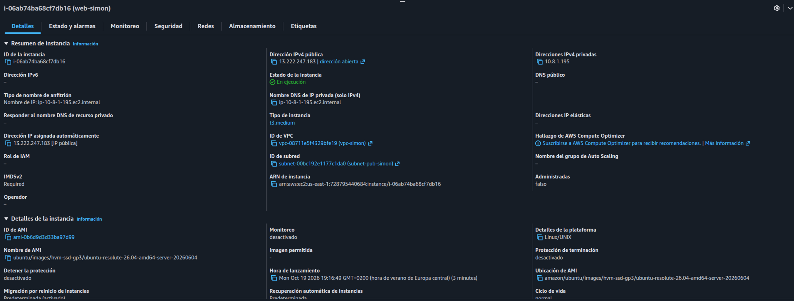

## Mapa de recursos de la VPC

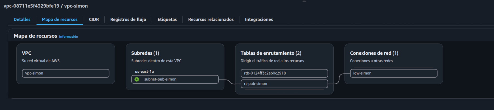

## Salida de timedatectl

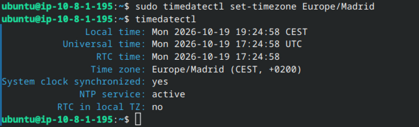

---

# Apartado 2. Instalación y configuración básica de Nginx

## Configuracion de los sitios de Nginx

* Creo la carpeta para el sitio:
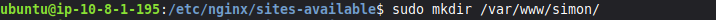

* Cambio la ruta del sitio por defecto para que apunte a mi nueva carpeta:


* Creo un archivo simple index.html:


* Creo `/var/www/simon/estado/index.html` con un texto simple que indica que el servidor funciona:
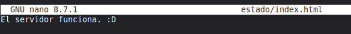

* Modifico el archivo `/etc/nginx/nginx.conf` para ocultar la versión de Nginx en las cabeceras. Se cambia el valor de esta línea a `off`:
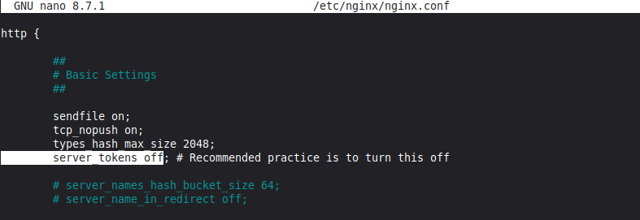

* Verifico la configuración de Nginx, y siendo correcta la aplico y reinicio el servicio:


## Archivos nginx.conf y sites-available/default:

[nginx.conf](evidencias/nginx.conf)
[sites-available/default](nginx/sites-available/default)

## Cabeceras antes de ocultar la versión


## Cabeceras *después* de ocultar la versión

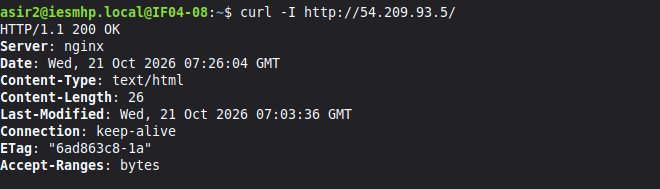

## Respuesta de `/estado/`


# Apartado 3. Sitios virtuales

## Contenido de sites-enabled


## Intranet

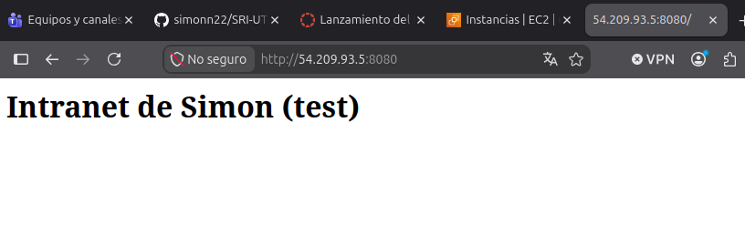

* Su archivo de configuración:
[intranet.conf](nginx/sites-available/intranet.conf)

## Sitio por defecto

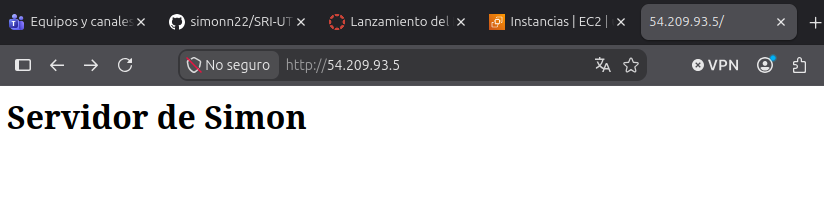

* Su archivo de configuración:
[default](nginx/sites-available/default)

## simon.test

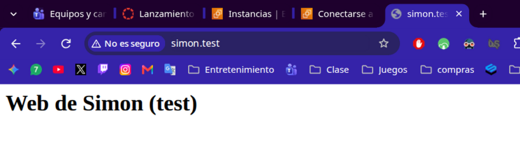

* Su archivo de configuración:
[simon.conf](nginx/sites-available/simon.conf)

## blog.simon.test

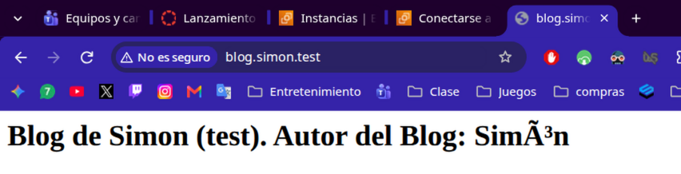

* Su archivo de configuración:
[blogsimon.conf](nginx/sites-available/blogsimon.conf)

## Archivo `hosts` de mi máquina local

[hosts](evidencias/hosts)

---

# Apartado 4. Ampliar Nginx con módulos

Para este apartado, instalo en el servidor los paquetes `libnginx-mod-http-fancyindexy` y `php-fpm`.

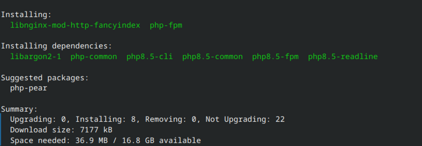

También creo las carpetas y archivos necesarios para probar que todo funciona como debe:

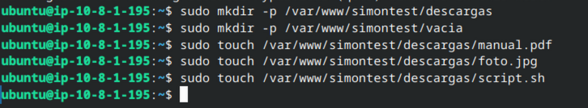

## hora.php

Creo el archivo `/var/www/simontest/hora.php` y añado el siguiente código:

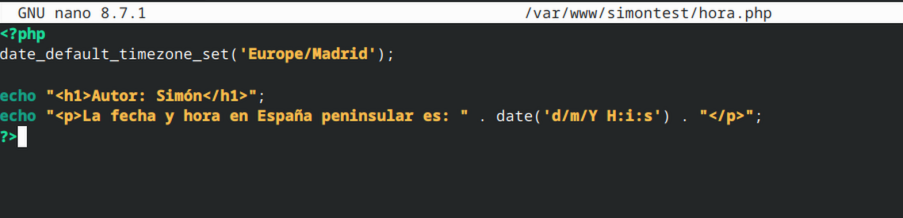

## `simon.conf` adaptado para implementar `hora.php` y `fancyindex`

[simon.conf actualizado](nginx/sites-available/simon_A4.conf)

Como explico en los comentarios:

* Para indicar a `fancyindex` que muestre un tamaño de archivo legible y no el tamaño exacto, se utiliza `fancyindex_exact_size off`
* Para decirle al servidor cómo comunivarse con php, lo indica el bloque `location ~ \.php$`

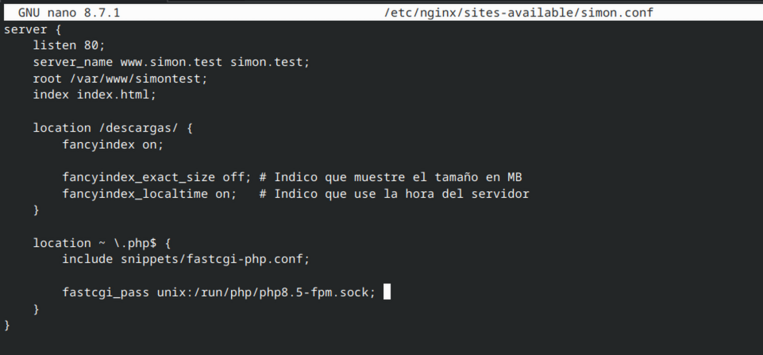

## `/descargas/` con fancyindex

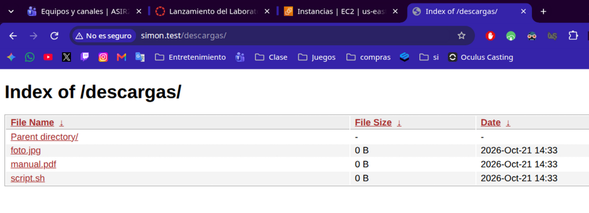

## Error `403 Forbidden` en el resto de carpetas

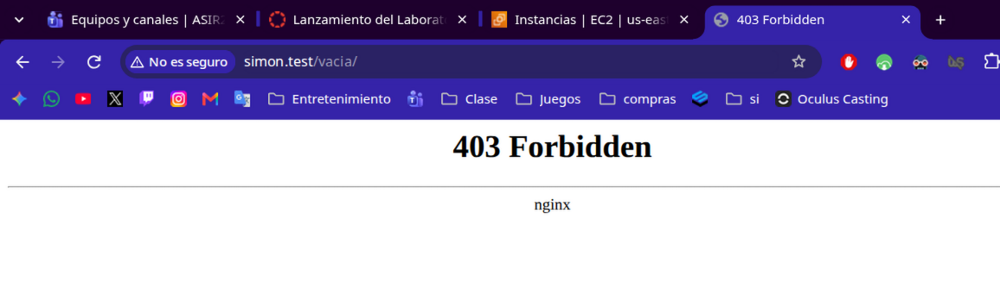

---

# Apartado 5. Autenticación y control de acceso

## Instalar `apache2-utils`

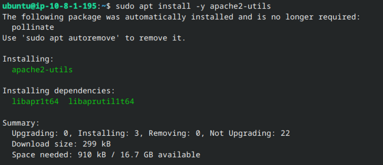

### Averiguar IP pública de mi equipo

Para esto uso echo `$SSH_CLIENT` mientras estoy conectado a la máquina remota.

## Fichero para `intranet`

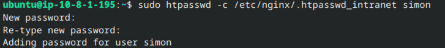

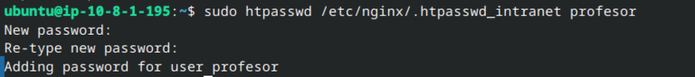

## Fichero para Admin

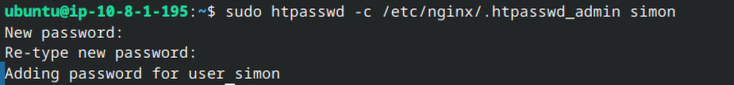

### Ajustar permisos de los ficheros

Para cumplir el requisito de que solo root y www-data puedan leerlos, cambio el propietario y los permisos:

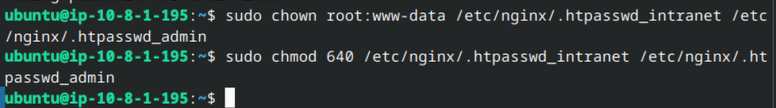

## Editar el archivo `intranet.conf`

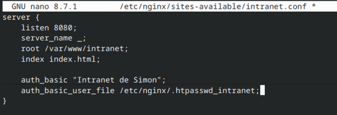

[intranet.conf actualizado](nginx/sites-available/intranet_A5.conf)

## Configurar web principal (carpeta `/admin/`)

En este caso la configuración solo se aplica dentro del bloque location /admin/ para que solo pida autenticación ahí:

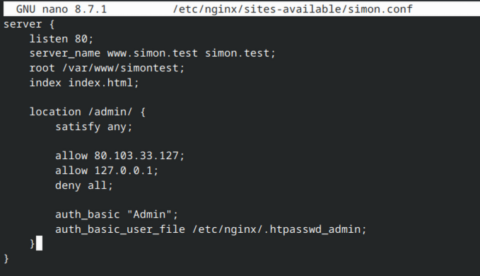

[simon.conf actualizado](nginx/sites-available/simon_A5.conf)

## Acceso a la intranet

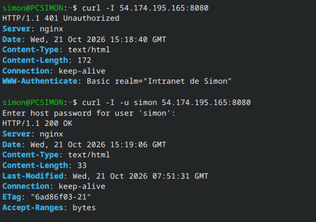

## Acceso a /admin/ desde la IP permitida

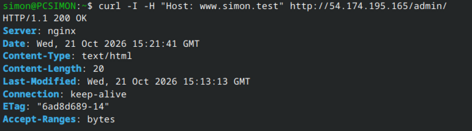

## Acceso a /admin/ desde el propio servidor

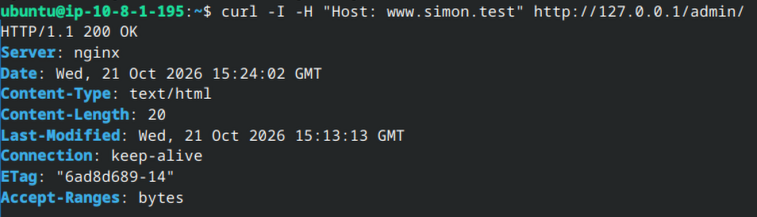

## Acceso a /admin/ desde fuera de la red

Como puede comprobarse, estando fuera de la red solicita usuario para acceder a `/admin/`.
En caso de intentar entrar como `profesor`, rechaza el acceso, pero al entrar como `simon` sí lo permite.

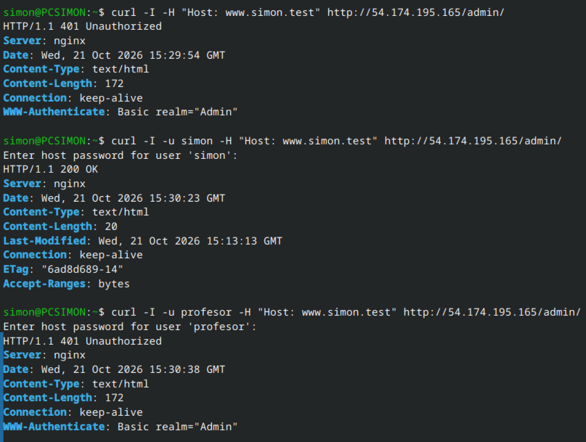

---

# Apartado 6. Registros: estadísticas e incidencias

## 6.1. Un registro para cada sitio

Los siguientes cambios se añadirán bajo server_name:

### En simon.conf se añade lo siguiente

```nginx
access_log /var/log/nginx/simon.access.log;
error_log  /var/log/nginx/simon.error.log;
```

[Archivo actualizado](nginx/sites-available/simon_A6.conf)

### En blogsimon.conf se añade lo siguiente

```nginx
access_log /var/log/nginx/blog.access.log;
error_log  /var/log/nginx/blog.error.log;
```

[Archivo actualizado](nginx/sites-available/blogsimon_A6.conf)

### En intranet.conf se añade lo siguiente

```nginx
access_log /var/log/nginx/intranet.access.log;
error_log  /var/log/nginx/intranet.error.log;
```

[Archivo actualizado](nginx/sites-available/intranet_A6.conf)

## 6.2. Estadísticas desde la terminal

Se han realizado intentos variados, como accesos correctos, con usuario incorrecto, estando fuera de la red permitida para entrar a /admin/ etc.

### Para ver el numero total de peticiones

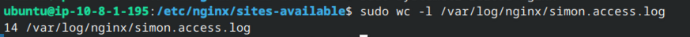

### Para ver las 5 IP que más peticiones hacen

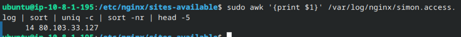

### Para ver cuántas respuestas hay de cada código

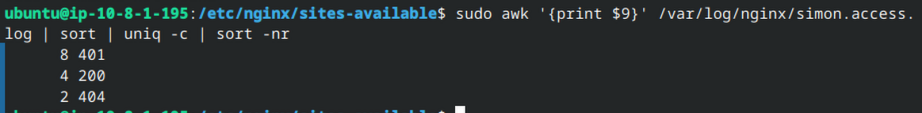

### Para ver qué rutas dan 404 y cuántas veces

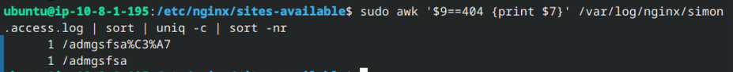

### Para ver la hora del día con más peticiones

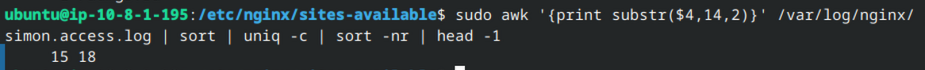

## Informe visual con GoAccess

Para instalarlo uso `sudo apt install -y goaccess`.

Para generar el informe uso `sudo goaccess /var/log/nginx/simon.access.log --log-format=COMBINED -o /var/www/intranet/informe.html`

Salida:

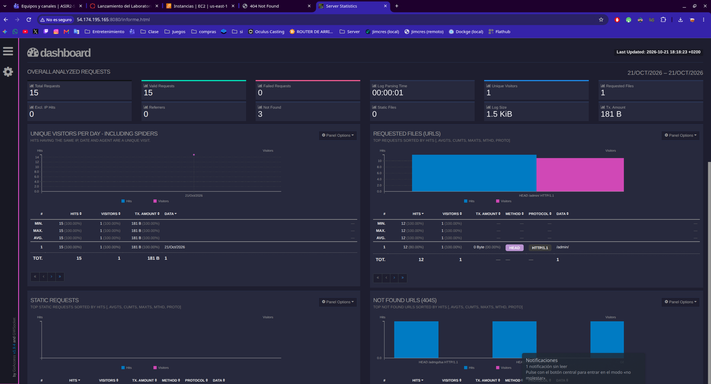