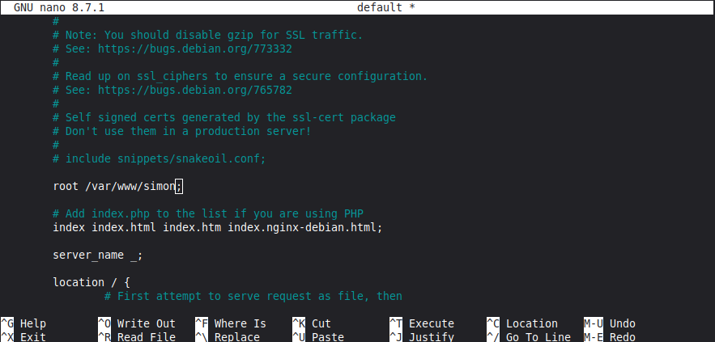
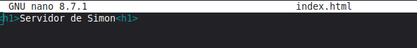
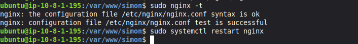
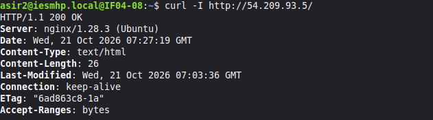
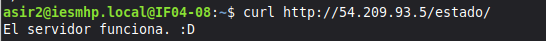
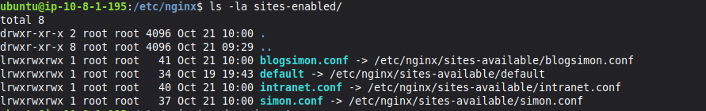
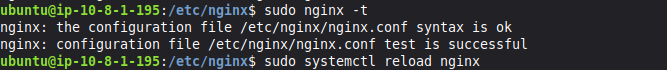

Esta es la tarea del alumno Simón Jiménez del curso ASIR2, módulo SRI.

# Apartado 1

### VPC:

### Subred pública:

### Grupo de seguridad con mínimo privilegio:

### Instancia EC2:

#### Detalles de la instancia:

## Mapa de recursos de la VPC

## Salida de timedatectl

---

# Apartado 2. Instalación y configuración básica de Nginx

## Configuracion de los sitios de Nginx

* Creo la carpeta para el sitio:

* Cambio la ruta del sitio por defecto para que apunte a mi nueva carpeta:

* Creo un archivo simple index.html:

* Creo `/var/www/simon/estado/index.html` con un texto simple que indica que el servidor funciona:

* Modifico el archivo `/etc/nginx/nginx.conf` para ocultar la versión de Nginx en las cabeceras. Se cambia el valor de esta línea a `off`:

* Verifico la configuración de Nginx, y siendo correcta la aplico y reinicio el servicio:

## Archivos nginx.conf y sites-available/default:

[nginx.conf](evidencias/nginx.conf)
[sites-available/default](evidencias/default)

## Cabeceras antes de ocultar la versión

## Cabeceras *después* de ocultar la versión

## Respuesta de `/estado/`

# Apartado 3. Sitios virtuales

## Contenido de sites-enabled

## Intranet

## Sitio por defecto

AÑADIR CAPTURAS DE LOS OTROS SITIOS Y SUBIR EL ARCHIVO HOSTS Y LOS FICHEROS DE CONFIGURACION DE LOS TRES SITIOS